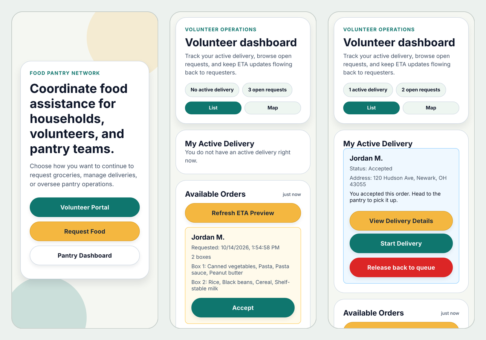

# FPN Delivery

**A volunteer food delivery app for the Licking County Food Pantry Network**


Team project for CS 349, Denison University, Spring 2026 · Team Delivery: Safal, Hamdan, Ethan, Max, Beck and Nhien



*Landing page, volunteer dashboard with open orders broken down by box, and an accepted delivery. Shown with demo data.*

Some pantry clients in Licking County, Ohio can't get to a pantry in person. FPN Delivery lets them order groceries from their phone and have a volunteer driver bring them home. The app has three roles:

* **Requesters** sign in with their phone number and date of birth, confirm a code sent by SMS, build an order from the pantry's boxes and items, and track the delivery live.
* **Volunteers** sign up, see open deliveries on a map with an ETA, check box contents before accepting, share their location while driving, and upload a photo as proof of delivery.
* **Pantry staff** manage the menu, cancel stuck orders, and resolve complaints from an admin dashboard.

## My contributions

I learned React Native, Expo and Supabase from scratch for this project and contributed in every sprint, across the frontend, notifications and parts of the backend.

**Sign in and navigation**
* Built the sign in screen with Supabase Auth, the mode selection screen, and the shared Supabase client the whole team used.
* Built the post login navigation and role routing: the Volunteer Portal, the requester login screen, and the disclaimer modal.
* Fixed a navigation persistence bug and a double initialization bug in the root layout.

**Notifications, from push to SMS**
* Implemented push notifications with expo-notifications, a `push_tokens` table in Supabase, and Realtime triggers for when an order is created, accepted or delivered.
* When push stalled (iOS needs a paid developer account, and Expo Go dropped remote push in SDK 53), I moved the team to SMS. Twilio needed A2P 10DLC carrier registration that takes weeks, so I switched to TextBelt, which handles registration itself. Customers now get a real text when a volunteer accepts their order.
* Restored the SMS triggers after they were lost in a merge.

**Volunteer experience**
* Added the box preview, so volunteers see each order's boxes and items before accepting it.
* Added live GPS location sharing during a delivery with `watchPositionAsync`, behind a clear "Share My Location with Customer" action.
* Simplified volunteer sign in to email only and separated the status text volunteers see from what customers see.

**Build and backend**
* Set up the EAS build configuration for iOS and Android builds.
* Stepped in on backend work when the team needed it: SQL queries, Supabase tables and Realtime subscriptions.

## How it works

```
Expo app (iOS, Android, web)
  ├── Supabase: auth, orders, menu, realtime updates, delivery photo storage
  └── Node/Express demo API: requester phone verification, SMS through TextBelt
```

* **Live order status.** Requester and volunteer screens subscribe to Supabase realtime, so status and ETA changes show up without refreshing.
* **ETA.** The haversine distance between the volunteer and the drop off address gives the ETA. While a delivery is in transit, the volunteer's location is shared every two minutes.
* **Proof of delivery.** A database rule blocks an order from being marked delivered until a photo has been uploaded (`supabase/migrations`).

## Tech stack

Expo, React Native, Expo Router, Supabase (Postgres, auth, realtime, storage), Node.js, Express, Jest, Playwright

## Repository layout

```
.
└── volunteer-delivery-app/
    ├── app/                     Expo Router screens
    ├── components/              shared UI and map views
    ├── lib/                     order status, tracking, realtime helpers
    ├── services/                Supabase, geocoding, notifications
    ├── server/                  local demo API
    ├── supabase/migrations/     SQL migrations
    ├── validators/              form validation and Jest tests
    ├── e2e/                     Playwright end to end tests
    └── scripts/                 demo data and test scripts
```

## Running it locally

You need your own Supabase project. Install dependencies:

```bash
cd volunteer-delivery-app
npm install
```

Create `volunteer-delivery-app/.env`:

```bash
EXPO_PUBLIC_SUPABASE_URL=your-supabase-url
EXPO_PUBLIC_SUPABASE_ANON_KEY=your-supabase-anon-key
EXPO_PUBLIC_DEMO_API_URL=http://localhost:4000
SUPABASE_SERVICE_ROLE_KEY=your-service-role-key
TEXTBELT_KEY=your-textbelt-key   # optional, for real SMS
```

Keep `SUPABASE_SERVICE_ROLE_KEY` on the server only. Then start the demo API and the app:

```bash
npm run server
npm run start      # or: npm run ios / android / web
```

Demo requester login: phone `1234567890`, date of birth `01/01/2001`, code `123456`. This account skips the SMS step. The other demo users in `server/data/pantry-users.json` are fictional.

## Tests

```bash
npm run test             # Jest unit tests for the sign in validators
npm run test:coverage
npm run web:e2e          # serve the web build
npm run test:e2e         # Playwright: requester orders, volunteer accepts and delivers
```

The Playwright suite drives the requester and volunteer apps in a browser: sign in validation, multi box orders, an order going from placed to accepted to delivered, cancellations, and the rule that a volunteer can only hold one active delivery.

## Limitations

This was built as a course project, not for production. The admin dashboard uses a shared demo password, and requester verification runs on a local demo API instead of a hosted service.

## Credits

Built by Team Delivery: Safal, Hamdan, Ethan, Max, Beck and Nhien. The original repository is private to the team. This copy is published with the team's permission, without the commit history.
